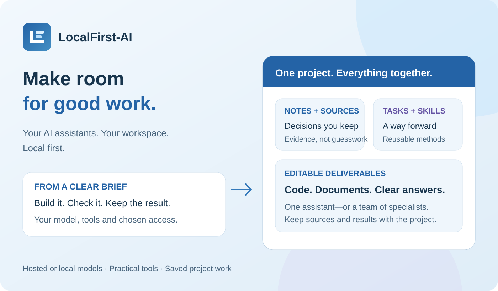

# LocalFirst-AI

> Your AI assistants. Your workspace. Local first.

**Give your assistant a project, not just a question.** LocalFirst-AI brings your chosen models, practical tools and saved project work together. Build an application, research a decision, create a project costing or prepare a client handover—with the conversations, evidence and deliverables kept in one place.

[Download](#download) · [V1.0 overview](RELEASE.md) · [Get started](GETTING-STARTED.md) · [User guides](docs/README.md) · [Official website](https://localfirst-ai.com)

## What you can do

| Capability | How it helps |
|---|---|
| **Choose your models** | Connect hosted APIs or compatible local/self-hosted endpoints. Save profiles and choose different models for Chat, supporting work, Rooms and workspaces. |
| **Organise projects** | Give each assistant a Room and each project its own workspace, with a conversation, editable notes, tasks, attachments and artifacts. |
| **Complete practical work** | Let a capable model read and edit approved files, run builds and tests, research sources, create deliverables and check its results. |
| **Coordinate specialists** | Opt into Supervisor workspaces, assign focused workers, follow progress and combine results. Nested teams and shared limits are optional. |
| **Reuse your methods** | Create or import text-based Skills, review versions, choose when they apply and request a Skill for one message. Save useful workflows as editable drafts. |
| **Work with documents** | Read supported attachments and local documents; create editable Word, Excel and PowerPoint files, PDFs and other exports. OCR and format coverage depend on configuration. |
| **See the information** | Use inline charts, comparison matrices, metrics, timelines, process flows and other visual summaries. Copy or save a visual as an image. |
| **Research with sources** | Add web search and grounding through a separately configured service. Keep findings and citations with the project. |
| **Create media** | Configure image generation/editing, supported video services, speech, transcription and realtime interaction when needed. |
| **Keep the handover** | Export saved messages and copy original document, image and attachment bytes without regenerating them. Back up and restore supported app data. |
| **Extend the workspace** | Choose built-in Direct or searchable Gateway tools and connect trusted compatible MCP servers or plugins. |
| **Work comfortably** | Use the airy Sky light theme or complementary Midnight dark theme, with system/light/dark appearance choices. |

## One assistant—or a coordinated team

Use one assistant for a focused job. For a larger project, enable **Supervisor delegation** in Workspace settings and give each specialist a clear, non-overlapping responsibility. Review returned findings, open worker workspaces and keep the combined outcome with the project.

Control team size, concurrency, request allowances, duration and nesting. Stop work that no longer fits the brief. **Stopping does not undo completed actions**, and interrupted assignments are not automatically replayed after closing the app. Delegation limits are not provider spending caps or an operating-system sandbox.

[Supervisor guide](docs/supervisor-workspaces.md) · [Independent assistants](docs/independent-assistants.md)

## Skills for the way you work

Keep a writing style, research method, coding convention or checklist ready to reuse. Create or import trusted guidance in **Settings → Skills**, then choose **When relevant**, **Only when requested** or **Off** for the project. The message box's compact picker requests guidance without inserting it into your typed question.

Review drafts before making them available. Use **Make available globally** to reuse the same Skill across projects while preserving its identity and version history. Existing projects keep their selected version until you change it. Skills contain instructions and text references; bundled scripts are not executed and Skills cannot grant access.

[Skills guide](docs/skills.md)

## Start with something useful

- **Build:** create a small internal app, run its tests and retain setup instructions. [Application example](docs/use-cases.md#build-a-complete-application-from-a-brief)
- **Cost:** reconcile quantities, rates and assumptions into an editable workbook and client report. [Costing example](docs/use-cases.md#produce-a-complete-project-costing)
- **Research:** compare options with sources, identify uncertainty and save a decision brief. [Examples](docs/use-cases.md)
- **Coordinate:** ask specialists for separate read-only reviews, then one prioritised report. [Team example](docs/use-cases.md#coordinate-a-repository-review-with-a-team)

## Download

Use the [official GitHub Releases page](https://github.com/daemosofchaos/localfirst-ai-preview/releases) for published packages and their **SHA-256 checksum manifest**. Read [RELEASE.md](RELEASE.md) for the V1.0 product overview.

| Package | Choose this when… |
|---|---|
| Windows x64 installer | You want a normal installation for your Windows account. |
| Windows x64 portable ZIP | You want to extract the entire app and run it without an installer. |
| Android APK | You want to sideload on Android 7.0+ arm64-v8a devices or an x86_64 emulator. |
| Android package ZIP | You want the APK with the licence and reference documents. |
| SHA-256 manifest | Verify each downloaded file before installing or running it. |

Windows is the primary desktop experience; Android has more limited device and tool coverage. No public Web, macOS or iOS package is promised. Follow [Getting started](GETTING-STARTED.md#install-localfirst-ai). If a package is not attached to the release, do not substitute an unofficial download.

## Your first workspace

1. Install a verified official package.
2. Connect a text model and assign it to **Chat**. Utility is optional; other capabilities can wait.
3. Create a Room and use its Main workspace for a small, non-sensitive task.
4. Ask the assistant to save a short brief as a note and three next steps as tasks.
5. Review the saved records before granting broader tool or file access.

[Connect a model](docs/model-setup.md) · [Local models](docs/local-models.md) · [Workspaces and tools](docs/workspaces-and-tools.md) · [Documents and exports](docs/documents-and-exports.md) · [Images and voice](docs/images-and-voice.md)

## Costs, privacy and responsibility

> **Bring your own model means bring your own account or server.** LocalFirst-AI does not include API keys, model downloads, credits, a token allowance or hosting. You are responsible for connected-provider and infrastructure charges, including retries, tools, supporting models and delegated work. Consumer chat subscriptions do not necessarily include API access. Set provider-side budgets, quotas and hard limits where available. **The app's usage view and team limits are not hard spending controls; provider billing records are authoritative.**

Local-first is not automatically offline: configured services may receive prompts, guidance, files and tool results. Tools may affect real files, applications and services within available permissions. Prompts and Skills are not a sandbox. Keep backups, protect credentials and verify important output. AI results can be wrong or harmful; you are responsible for how you use the platform and its outputs.

Official binaries are provided **as is and as available**, without warranty or a service-level commitment, under the [binary application licence](LICENSE.md). **Personal and commercial use of the unmodified app is permitted without an application-use fee under this licence.** Reverse engineering, decompilation and redistribution of the binaries are restricted, subject to mandatory law and third-party rights. Liability exclusions apply only to the extent permitted by law.

[Usage scope and limitations](PREVIEW.md) · [Privacy](PRIVACY.md) · [Security](SECURITY.md) · [Billing](TOKEN-USAGE-AND-BILLING.md) · [Licence](LICENSE.md)

## Help and feedback

Start with [Troubleshooting](docs/troubleshooting.md). Report a reproducible bug or focused suggestion through [GitHub Issues](https://github.com/daemosofchaos/localfirst-ai-preview/issues), following [Support](SUPPORT.md). Never publish keys, confidential prompts, private endpoints or sensitive files. Use a private channel for suspected vulnerabilities.

This repository distributes public documentation and official binary releases, **not the application source code**.
